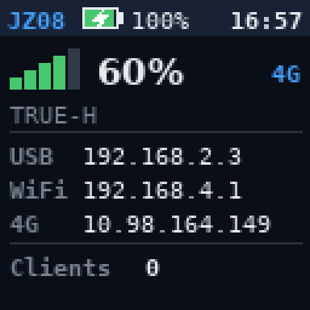

# OpenStick Debian on the JZ08C pocket WiFi (with TFT screen)

How to run Debian 12 ([OpenStick](https://github.com/kinsamanka/OpenStick-Builder)) on the **JZ08C V50** 4G pocket WiFi (Qualcomm MSM8916). The board has a 1.44" TFT screen and a battery. With this repo the screen, battery charging, backlight, power button and 4G all work.

<p align="center">
  
</p>

> [!WARNING]
> Flashing replaces the bootloader and partition table. Back up the whole eMMC first and keep the backup. EDL mode is in the SoC ROM, so you can always restore.

## Board

| | |
|---|---|
| PCB marking | `JZ08C_V50_20250930` (sticker `JZ08A-XPA-…-R3`) |
| SoC | Qualcomm MSM8916, secure boot **off** |
| RAM / eMMC | 512 MB (317 MB usable) / 3.64 GiB SK hynix `H4G2a` |
| CPU | 4× Cortex-A53, up to 998 MHz |
| Screen | ST7735S 128×128 on SPI (BLSP1 QUP4) |
| Battery | 1500 mAh Li-ion, PM8916 linear charger |
| Stock OS | Android 4.4, web UI `UFI-JZ_V3.0.0` at 192.168.100.1. Stock USB is mass-storage only, no ADB. |

## Entering EDL

Short pad **`BOOT`** to pad **`1P8`** (1.8 V; the silkscreen looks like `IP8`) on the screen side, next to `DP DM VBUS VBAT GND`. Keep the **battery connected**, then plug in USB. The board shows up as `05c6:9008`.

Shorting `BOOT` to `GND` does **not** work. Never touch `VBUS` or `VBAT` with the jumper.

The board does not power on from USB alone. Keep the battery connected when booting.

## Flashing

The JZ08C uses the same partition layout as the JZ0145. The recipe from [jz0145-v40-openstick](https://github.com/Yeet2042/jz0145-v40-openstick) works unchanged: OpenStick-Builder v0.2, the db410c firmware **plus `cdt`**, qhypstub, lk1st, and the `msm8916-jz01-45-v33` dtb.

```bash
git clone https://github.com/Yeet2042/jz0145-v40-openstick
cd jz0145-v40-openstick
./flash.sh prepare
./flash.sh backup      # EDL (BOOT↔1P8)
./flash.sh lk1st       # EDL
./flash.sh flash       # fastboot: run it right after the board enters fastboot
./flash.sh restore     # restores IMEI/calibration partitions and reboots
```

After about a minute, join WiFi `Openstick` (password `openstick`) and run `ssh user@192.168.4.1` (password `1`).

Out of the box: WiFi AP, modem with the original IMEI, SIM and 4G, and Bluetooth all work. On this board the SIM switch GPIOs match the v33 defaults, unlike the JZ0145 v40.

## Extras: screen, battery, backlight, buttons

Copy this repo to the board, then run:

```bash
sudo ./install.sh          # add --ecm to use CDC-ECM USB networking (macOS)
sudo reboot
```

What it installs:

| | |
|---|---|
| `dts/msm8916-jz08c.dts` | The v33 dtb plus the JZ08C hardware below. A compiled `.dtb` is included. |
| `firmware/jz08c-st7735s.bin` | Panel init sequence for `panel-mipi-dbi`, converted from the stock dtb with `tools/mkfw.py` |
| `driver/jz08c_bl.c` | Small kernel module for switching the backlight. A prebuilt `.ko` for `6.6.0-msm8916` is included. |
| `board/jz-status.py` | Status screen showing battery, time, 4G signal, operator, IPs and WiFi clients. A short press of the power button turns the screen on or off. |
| `board/jz-lowbat` + timer | Shuts down cleanly when on battery and at or below 5% |
| `board/logind-powerkey.conf` | A short power-key press no longer shuts down. A long press does. |

### What the dtb adds

| Hardware | Pins / config |
|---|---|
| TFT (ST7735S) | `spi@78b8000` with `cs-gpios` gpio14. `panel-mipi-dbi-spi`: DC gpio116, RESET gpio118 (**active high**), x/y offset 2/3 |
| Panel supplies | `power-supply` = L17 at 2.85 V, `io-supply` = L6 at 1.8 V |
| Backlight | PM8916 **MPP4** in current-sink mode, 40 mA |
| Charger / fuel gauge | `pm8916-lbc` and `pm8916-bms-vm` enabled, with a `simple-battery` node (1500 mAh, 4.2 V, OCV table from stock) |
| USB VBUS detect | `usb-detect@1300` disabled. USB `extcon` comes from the charger instead. |
| LEDs | gpio9 red and gpio31 green (three lamps under the screen), gpio7 green (mid-board). gpio6 and gpio8 from the v33 dtb aren't connected. |

## Things that cost time (gotchas)

- **White screen, take 1:** the panel supply L17 was off and had no voltage set in the v33 dtb. The stock dtb shows `vdd` = L17 (2.85 V) and `vddio` = L6.
- **White screen, take 2:** `reset-gpios` must be `GPIO_ACTIVE_HIGH` for `drm_mipi_dbi`. With active-low the panel is held in reset forever.
- **The panel driver doesn't autoload.** The SPI modalias is the first compatible, so `panel-mipi-dbi` goes in `modules-load.d`.
- **`pm8916-lbc` fails with `-EBUSY`** because it shares the `usb_vbus` IRQ with `usb-detect@1300`. Disable `usb-detect` and point the USB controller's `extcon` at the charger.
- **`pm8916-lbc` "Error while parsing device tree":** the driver needs `qcom,fast-charge-safe-voltage` and `qcom,fast-charge-safe-current`. The safe current is also the charge current.
- **MPP `drive-strength` is written raw into `SINK_CTL`.** Use the register code (7 = 40 mA), not mA.
- **The backlight can't be switched through gpio/LED.** In sink mode the GPIO value only flips the mode bit. The sink is gated by the MPP master enable (`EN_CTL` bit 7), which pinctrl only sets at probe. `jz08c_bl` writes it through the PMIC regmap. Afterwards, don't touch the MPP through pinctrl or gpio: that rewrites `EN_CTL` from the pinctrl cache.
- **The board shut down when the power button was pressed.** systemd-logind's default for a short press is power-off.
- **lk1st fastboot can hang** if it sits idle after `oem` debug commands. Flash right after the board enters fastboot.

## Building the backlight module

```bash
ssh user@<board> 'zcat /proc/config.gz' > config
driver/build-docker.sh config      # arm64 Debian container; fine on Apple Silicon (OrbStack/Docker)
```

The OpenStick kernel has no `MODVERSIONS` or module signing. The module only needs a matching `vermagic` (`6.6.0-msm8916 SMP preempt mod_unload aarch64`).

## Tools

- `tools/dtbtool.py`: extract and dump the device trees from a stock Android `boot` image
- `tools/mkfw.py`: convert a Qualcomm `mdss-spi-on-command` blob into a `panel-mipi-dbi` firmware file
- `tools/ledscan.py`: toggle each free GPIO while showing its number on the TFT, to find LEDs by eye

## Credits

- [kinsamanka](https://github.com/kinsamanka): OpenStick-Builder and the JZxx install recipe
- [msm8916-mainline](https://github.com/msm8916-mainline) and [postmarketOS](https://postmarketos.org): the mainline kernel, the `pm8916-lbc` and `pm8916-bms-vm` drivers, lk2nd, and qhypstub
- [bkerler/edl](https://github.com/bkerler/edl)
- Bring-up, the device tree, the backlight driver, the scripts and this README were done together with **Claude (Opus 5.5)** by Anthropic, working in [Claude Code](https://claude.com/claude-code).

## License

Scripts and docs: MIT (see [LICENSE](LICENSE)). `driver/jz08c_bl.c`: GPL-2.0. `dts/` is derived from the OpenStick/msm8916-mainline device tree and keeps that tree's license. Qualcomm firmware and eMMC backups are not distributed here.
